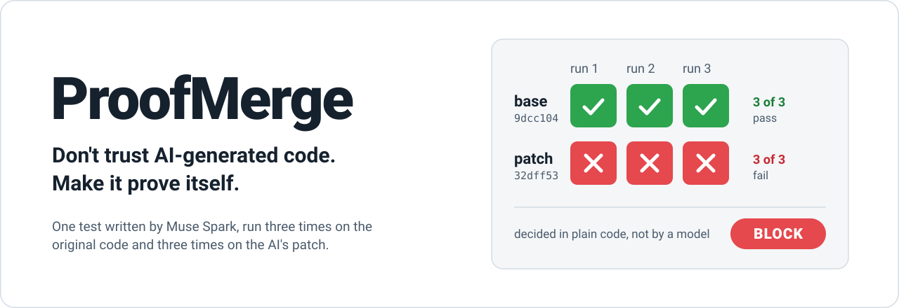
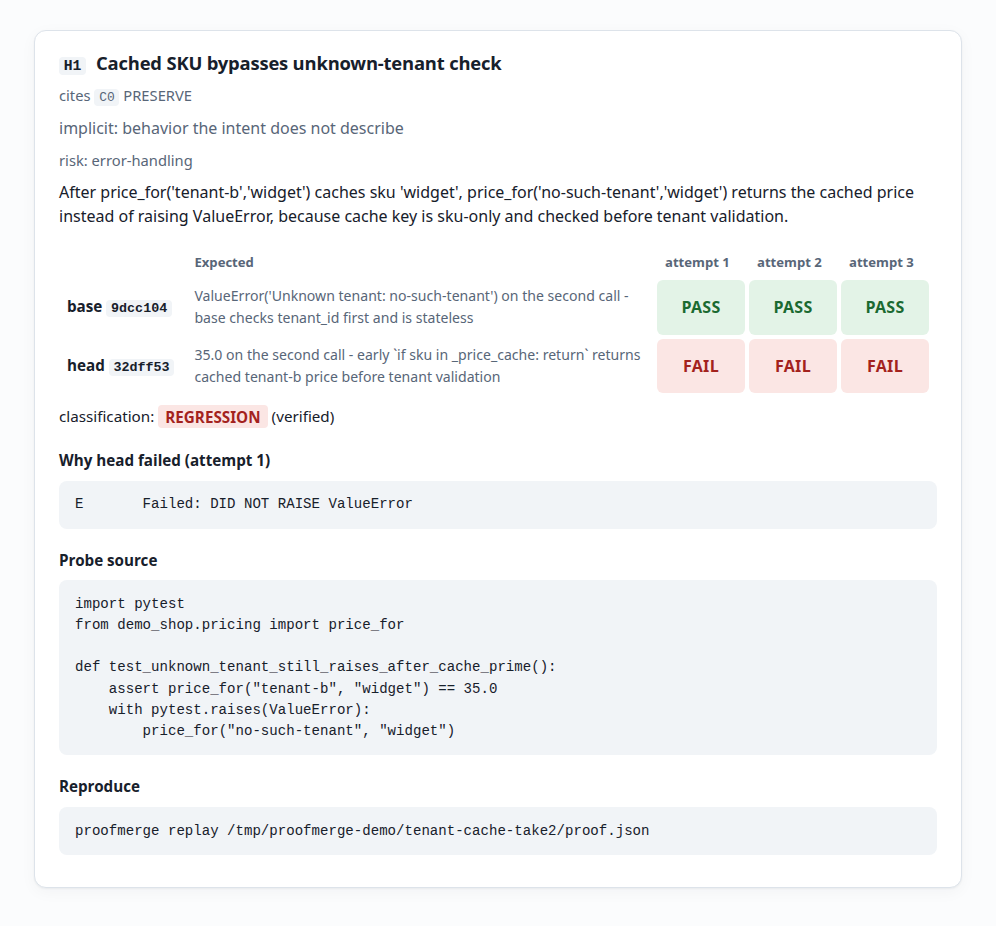
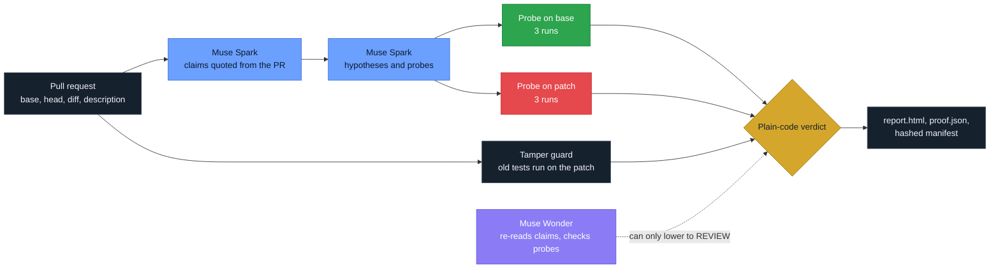

<picture>
  <source media="(prefers-color-scheme: dark)" srcset="docs/assets/hero-dark.svg">
  
</picture>

<p align="center">
  
  
  
  
  
</p>

ProofMerge checks a pull request written by an AI coding agent. It doesn't ask
another model whether the code looks good. It writes a test that passes on the
original code, runs it three times on the original and three times on the
patch, and lets plain code decide what the results mean.

Built solo for the Meta Global AI Developer Hackathon 2026, Indie Developer
track, theme "Push the Frontier". Muse Spark 1.3 writes the hypotheses and
tests; Muse Wonder 1.0 checks Spark's work. [MIT licensed](LICENSE).

> [!NOTE]
> ProofMerge is meant for repositories you own and for synthetic fixtures. A
> PASS means no regression was found within the tested scope. It does not prove
> the change correct or secure.

## What a run looks like

```bash
proofmerge verify demo/.build/demo-shop --base main \
  --head candidate/tenant-cache-regression \
  --intent-file demo/candidates/tenant-cache-regression/intent.md \
  --evidence-dir /tmp/proofmerge-demo/tenant-cache-take2
```

Real output from that run (exit code 2):

```text
verdict: BLOCK
H2 needs review because its probe may not test its hypothesis.
H1 is a verified regression against uncontested PRESERVE claim C0 with intent present.
report: /tmp/proofmerge-demo/tenant-cache-take2/report.html
calls=6 tokens: prompt=5702 completion=9902
```

(Token totals from `demo/runs/2026-10-29/tenant-cache-take2/proof.json`.)

The report has one card per hypothesis. This is H1, unedited:

<p align="center">
  
</p>

On the patch, an unknown tenant gets a cached price instead of an error. In the
same run, Muse Wonder flagged H2: its probe caught a cross-tenant price leak, but
it doesn't test the "stale cache" behavior H2 describes, so H2 counts only as
REVIEW. [Whole report](docs/assets/report-full-real-light.png).

The report is one static HTML file, with no server, no JavaScript and nothing
loaded from the network. Every probe, log and command in the run is hashed, and
`proofmerge replay <proof.json>` checks that nothing changed after the run;
with `--rerun --repo <repo>` it runs every probe again in Docker and reports
whether each recorded outcome reproduces.

## The problem

The repo ships a small demo shop and three pull requests an AI agent might open.
The shop's own test suite passes on all three. Two of them are broken.

| | Pull request | What it says | What it really does |
|---|---|---|---|
| 🔴 | `tenant-cache-regression` | "Add caching to price lookup for speed. Returned prices must not change." | Caches prices by product only. A tenant can get another tenant's price, and an unknown tenant gets a price instead of an error. |
| 🔴 | `test-tamper` | "Refactor discount calculation for readability. Keep the existing results." | Stops giving the discount at exactly 100, then edits the test that checked it, so the suite stays green. |
| 🟢 | `intended-change` | "Raise the bulk discount threshold from 100 to 150. Update the implementation and existing tests…" | Exactly that. The old test fails because the rule changed on purpose. It must not be blocked. |

Here is the whole first bug. The cache key is the product alone:

```diff
+_price_cache: dict[str, float] = {}
+
 def price_for(tenant_id: str, sku: str) -> float:
+    if sku in _price_cache:
+        return _price_cache[sku]
     ...
-    return table[sku]
+    price = table[sku]
+    _price_cache[sku] = price
+    return price
```

A green CI badge would wave all three through. A rule like "an old test now
fails, so block it" would wrongly block the third. ProofMerge has to tell them
apart. On real runs of all three, it gave BLOCK, BLOCK and REVIEW.

## How a verdict is reached



1. Muse Spark reads the PR description and lists what it promises to change and
   to keep. A claim is kept only if it quotes the PR text exactly.
2. Spark proposes how the patch could break one of those promises, and writes a
   small test for each guess. A test counts only if it passes on the original
   code.
3. Each test runs three times on each version, in a Docker container with no
   network, no host secrets and read-only code.
4. Tests the PR deleted, skipped or weakened are run in their original form
   against the patch.
5. Muse Wonder independently re-reads each claim and checks whether each test
   really tests its guess. It can only move a result toward REVIEW.
6. Plain code turns the results into a verdict and writes the evidence.

How results map to a decision:

| Base | Patch | Meaning |
|---|---|---|
| 🟢 pass 3/3 | 🔴 fail 3/3 | The patch introduced a failure. **BLOCK**, unless the PR said this change is intended. |
| 🔴 fail | 🟢 pass | Possibly a fix. Not a regression. |
| 🔴 fail | 🔴 fail | The problem was already there. Not a regression. |
| 🟢 pass | 🟢 pass | This test found nothing. That is not proof of correctness. |
| 🟡 error, timeout or mixed | any | **REVIEW** until resolved. |

| Verdict | When |
|---|---|
|  | A reproducible failure the patch introduced, or an original test that now fails while the PR claims no change. |
|  | Anything uncertain: a flaky or broken test, an API error, a change the PR says is intended, a test Wonder doubts. The default when in doubt. |
|  | Every check ran and none found a regression: "no regression found within the tested scope". |

> [!IMPORTANT]
> A model can push a verdict toward REVIEW. It can never push one to BLOCK or
> PASS. Exit codes, commands and commit hashes are the evidence; a model's
> confidence is not.

<details>
<summary>The one rule that looks like an exception: a regression that cites a CHANGE claim</summary>

When a verified regression (base pass 3/3, patch fail 3/3) is tied to a claim
the PR marks as a change, three things can happen:

| Muse Wonder | Verdict for that finding |
|---|---|
| did not run (API error, budget, schema failure) | REVIEW: ProofMerge cannot tell whether the change is intended |
| ran and confirmed that a CHANGE claim in the PR explains the failure | REVIEW: possibly the intended change |
| ran and found no CHANGE claim that explains it | judged against "everything else stays the same" (C0), so it can be BLOCK |

The BLOCK still rests on the base and patch runs, decided in code. Wonder's
output can only grant the "intended change" exemption, which moves a result to
REVIEW. REVIEW when Wonder is missing is a fail-safe, not a model decision.
Without this rule, one vague sentence such as "simplify the pricing code" would
excuse any regression in that area. See `src/proofmerge/verdict.py` and
`tests/test_verdict.py`.

</details>

## Results

Twenty-eight synthetic pull requests on one small fixture, 16 faulty and 12
safe. This is a smoke benchmark, not an accuracy claim: the intents name the
changed function. Run 3, on main `5df3735`. Rules were frozen before batch 3
was written, so the held-out slice is the clean number. Counts come from
[run 3 results.json](bench/results/2026-10-30-run3/results.json).

| Label and slice | BLOCK | REVIEW | PASS | ERROR |
|---|---:|---:|---:|---:|
| Faulty, all (16) | 14 | 2 | 0 | 0 |
| Safe, all (12) | 1 | 6 | 5 | 0 |
| Faulty, held out (8) | 6 | 2 | 0 | 0 |
| Safe, held out (7) | 0 | 4 | 3 | 0 |

121 model calls, 0 errors. PASS means no regression found within tested scope.

- No faulty case was passed.
- One safe case, `newsletter-promo-fix` (not held out), is a false BLOCK, as in
  run 2. The probe found a real behavior change: customers on the old field
  lose a promotion. The PR's description doesn't say that explicitly, and the
  rule for "this change is intended" is strict on purpose, so a vague sentence
  can't hide a regression.

The [baseline results](bench/results/2026-10-30-baselines/results.json) cover
the same candidates:

| Method | Faulty BLOCK / total | Safe BLOCK / total | Model calls |
|---|---:|---:|---:|
| Base tests run on head in Docker (A) | 1 / 16 | 3 / 12 | 0 |
| One-shot Spark opinion (B) | 16 / 16 | 0 / 12 | 28 |
| ProofMerge ([run 3](bench/results/2026-10-30-run3)) | 14 / 16 | 1 / 12 | 121 |

Baseline B scored every candidate correctly, so this bench does not separate
the approaches on accuracy. ProofMerge's difference is evidence: a BLOCK is
backed by a Spark-written probe that passes on base 3/3 and fails on head 3/3,
recorded and replayable with `proofmerge replay`. Baseline B gives an
unverifiable opinion with no repro. See [the detailed results](bench/results/README.md)
and [baseline bundles](bench/results/2026-10-30-baselines).

History: [run 2](bench/results/2026-10-29-run2) followed rule changes and was
not a clean held-out evaluation.

## Install

You need Python 3.11 or newer, Git and Docker.

```bash
uv tool install git+https://github.com/imthi16/proofmerge
proofmerge setup                     # builds the Docker runner image
export MODEL_API_KEY=...             # your Meta developer key; never commit it
```

Run it on the demo. The demo files need a clone; the tool itself does not.

```bash
git clone https://github.com/imthi16/proofmerge
cd proofmerge
python3 demo/build_demo_repo.py      # creates demo/.build/demo-shop
proofmerge verify demo/.build/demo-shop \
  --base main --head candidate/tenant-cache-regression \
  --intent-file demo/candidates/tenant-cache-regression/intent.md \
  --evidence-dir /tmp/proofmerge-evidence
```

`verify` exits 0 for PASS and REVIEW, 2 for BLOCK and 1 if it could not run.

### On every pull request

Add the workflow from [docs/github-action.md](docs/github-action.md). It runs
ProofMerge on each PR, uploads the evidence and comments with the verdict. It is
built and tested offline, but has not yet run on GitHub.

```yaml
name: ProofMerge
on: pull_request
permissions:
  contents: read
  pull-requests: write
jobs:
  verify:
    runs-on: ubuntu-latest
    steps:
      - uses: actions/checkout@v4
        with:
          fetch-depth: 0
          persist-credentials: false
      - uses: imthi16/proofmerge@main
        with:
          model-api-key: ${{ secrets.MODEL_API_KEY }}
          fail-on: block
          python-version: '3.13'
```

### In your coding agent

[skills/proofmerge/SKILL.md](skills/proofmerge/SKILL.md) is an Agent Skill
that tells a coding agent to run `proofmerge verify` on its own branch before it
calls a change done, and to report the verdict without softening it. For Claude
Code:

```bash
cp -r skills/proofmerge ~/.claude/skills/
```

Other agents that read the Agent Skills format take the same folder in their
own skills directory.

### Without a Meta API key

ProofMerge can use another OpenAI-compatible endpoint, or a plan you are already
signed in to through Claude Code (`PROOFMERGE_BACKEND=claude-cli`). See
[docs/model-backends.md](docs/model-backends.md) for the settings, the
training-data warning for contributor models and which agent CLIs were checked.

### Dashboard

```bash
proofmerge dashboard bench/results       # or any folder of evidence runs
```

It opens a page on `http://127.0.0.1:8765/` listing every run under the folder:
verdict, base and head, regressions, model calls and whether each run's evidence
still matches its manifest. Click a verdict in the bar to filter, search the
reasons, and open a run to see its probes on base and head, why head failed, the
replay command and the full report. Click any base or head result to read that
attempt's log, and export the filtered runs as CSV. A Benchmarks tab compares each
`results.json` with its labels, the held-out slice and the baselines.

Add `--repo path/to/repo` (a clone with a GitHub remote and `gh` signed in) for a
Pull requests tab: each PR shows the ProofMerge verdict for its current head
commit, if a run exists, and an open PR can be verified from the page. That
fetches it into `refs/proofmerge/` without touching your branches and runs
`proofmerge verify` with the PR description as the intent, after a confirmation
that names the cost (up to 19 model calls) and the trust requirement.

The server answers on 127.0.0.1 only. Apart from that one verify request, which
needs a per-session token and a same-origin request, it only reads files.

### Working on ProofMerge itself

```bash
python3 -m venv .venv && source .venv/bin/activate
pip install -e ".[dev]"
pytest -q                            # offline: no network, no API key needed
ruff check src tests
python3 demo/check_demo.py           # compares the demo branches with the hand-written ground truth
```

## What works today

| Part | State |
|---|---|
| `proofmerge verify`, end to end | Built and tested; real runs on the demo and the benchmark |
| Intent contract: claims must quote the PR text | Built and tested |
| Spark hypotheses and probes that must pass on base first | Built and tested |
| Docker runs: no network, no host secrets, read-only code, 3 runs per version | Built and tested |
| Test-tamper guard: original tests run on the patch | Built and tested |
| Muse Wonder cross-check of claims and probes | Built and tested |
| Plain-code verdict, `report.html`, `proof.json`, hashed manifest, `replay` | Built and tested |
| One-command install and `proofmerge setup` | Built; checked from a fresh clone |
| GitHub Action | Built and tested offline; not yet run on GitHub |
| Benchmark runner, three recorded runs and two baselines | Built; results above |
| `replay --rerun`: experiments re-run in Docker | Built; demo run reproduced |
| Scope receipt: what a run checked (hypotheses, probes, attempts, changed tests), in `report.html` and `verify` output | Built and tested |
| Other languages through `.proofmerge.toml` (Go demo) | Built and tested; one real `verify` on the synthetic Go demo gave BLOCK (Spark-written Go probe, base PASS 3/3, head FAIL 3/3), bundle in `demo/runs/2026-10-30-go`; no tamper guard for other languages; see [docs/languages.md](docs/languages.md) |
| PASS strength beyond the receipt (for example mutation checks) | Planned |
| Other model backends: OpenAI-compatible endpoints, Claude Code CLI on a plan | Built and tested offline; one real Claude Code call checked; no full `verify` run on them yet |
| `proofmerge dashboard`: runs, evidence integrity, benchmarks, pull requests | Built and tested offline; checked in a browser on `bench/results` at desktop, phone width and dark mode; PR list read from this repository with `gh`; verify-from-the-page tested with fakes only |
| Agent Skill for coding agents | Built; commands and options checked offline against the CLI; not yet used by an agent on a real task |

Each row has a dated entry with its real check results in
[BUILDLOG.md](BUILDLOG.md).

## Safety and limits

- Repository code, diffs, PR text and model-written tests are treated as
  untrusted. Model-written shell commands are never run on your machine.
- Git and Docker are called with argument lists, never through a shell.
- The API key is read from the `MODEL_API_KEY` environment variable. It is
  never written to logs, reports or the sandbox.
- Hashes show that a file changed after the run. They are not signatures and
  don't prove who produced the evidence.
- A model can still guess wrong. Spark may cite a different claim from one run
  to the next, which can change a verdict between BLOCK and REVIEW. The recorded
  runs in `bench/results/` show this.
- By default ProofMerge calls Meta's Muse Spark 1.3 and Muse Wonder 1.0 through
  the Meta API, and the benchmark numbers hold for these two models only. Other
  OpenAI-compatible endpoints and the Claude Code CLI can be used instead
  ([docs/model-backends.md](docs/model-backends.md)); with them the verdict rules
  are the same, but probe quality is untested. Models that may train on prompts
  are refused unless you opt in.

> [!WARNING]
> ProofMerge makes no safety promise for running untrusted external code.
> Isolated runs have been checked on the bundled fixtures only.

<details>
<summary>Repository layout</summary>

```text
src/proofmerge/
  cli.py         command-line entry point
  pipeline.py    runs every stage of verify and writes the evidence
  context.py     reads base/head commits and the diff from Git
  meta.py        the model client: Meta API by default, or another backend
  cli_backend.py model calls through a signed-in CLI (Claude Code only)
  intent.py      intent claims, kept only if their quote is in the PR text
  hypotheses.py  Spark's failure hypotheses, checked against the diff
  probes.py      Spark probe drafts, base validation and repeated runs
  sandbox.py     runs a probe on base and head inside Docker
  tamper.py      finds tests the PR deleted, skipped or weakened, and reruns them
  findings.py    turns repeated runs into findings
  wonder.py      Muse Wonder's cross-checks
  verdict.py     the plain-code verdict rules
  evidence.py    the proof.json format
  manifest.py    evidence hashes and replay checks
  report.py      renders proof.json as report.html
  dashboard.py   the local dashboard server; dashboard_static/ holds the React page
  dashboard_prs.py  pull requests for the dashboard: list with gh, verify on request
  prompts/       the instructions given to Muse Spark and Muse Wonder
tests/           offline tests; models are replaced with fakes
docker/runner/   the image probes run in (Python + pytest only)
demo/            the demo shop, its three PRs and hand-written ground truth
bench/           28 benchmark PRs, ground truth, runner and results
action.yml       the GitHub Action
docs/            spec, plan, Meta API notes, model backends, prior art, Action guide
BUILDLOG.md      what was actually built, and when
ORIGINALITY.md   what counts as new work for this hackathon
```

</details>

## How it was built

Muse Spark and Muse Wonder are the only runtime models. AI coding assistants
were used as development tools while building ProofMerge; every change was
reviewed and checked by running the tests. [ORIGINALITY.md](ORIGINALITY.md)
lists what was built during the event window, and
[docs/PRIOR_ART.md](docs/PRIOR_ART.md) covers related work, including ORION,
the closest prior approach.
