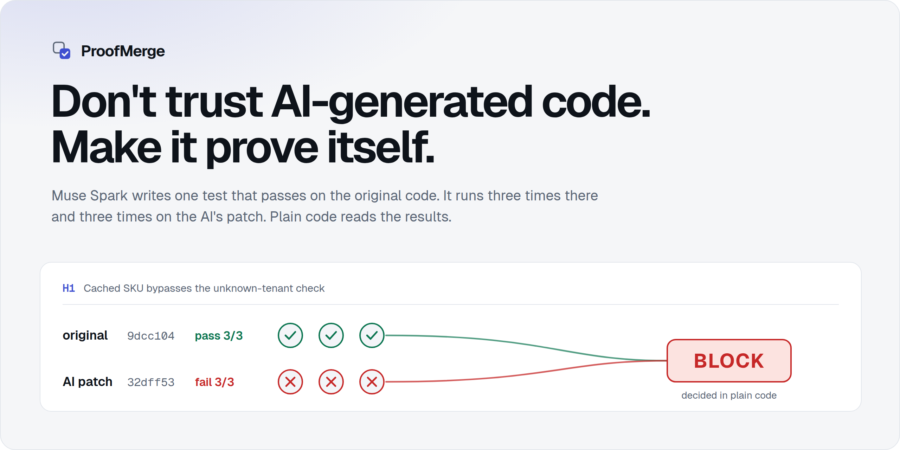
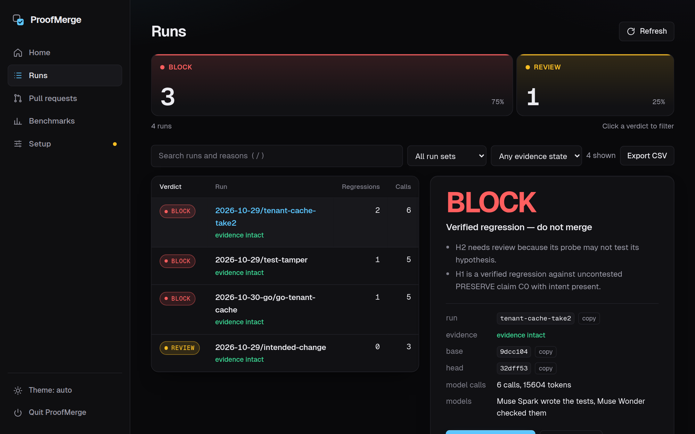
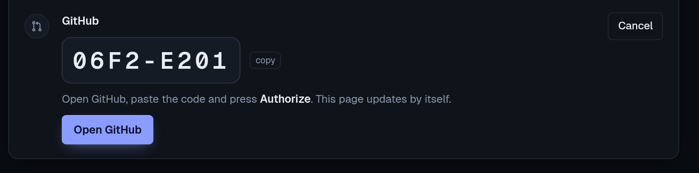
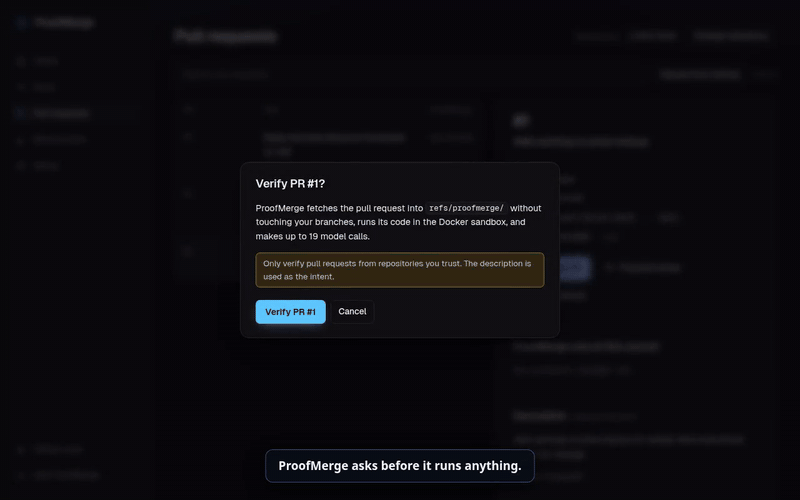
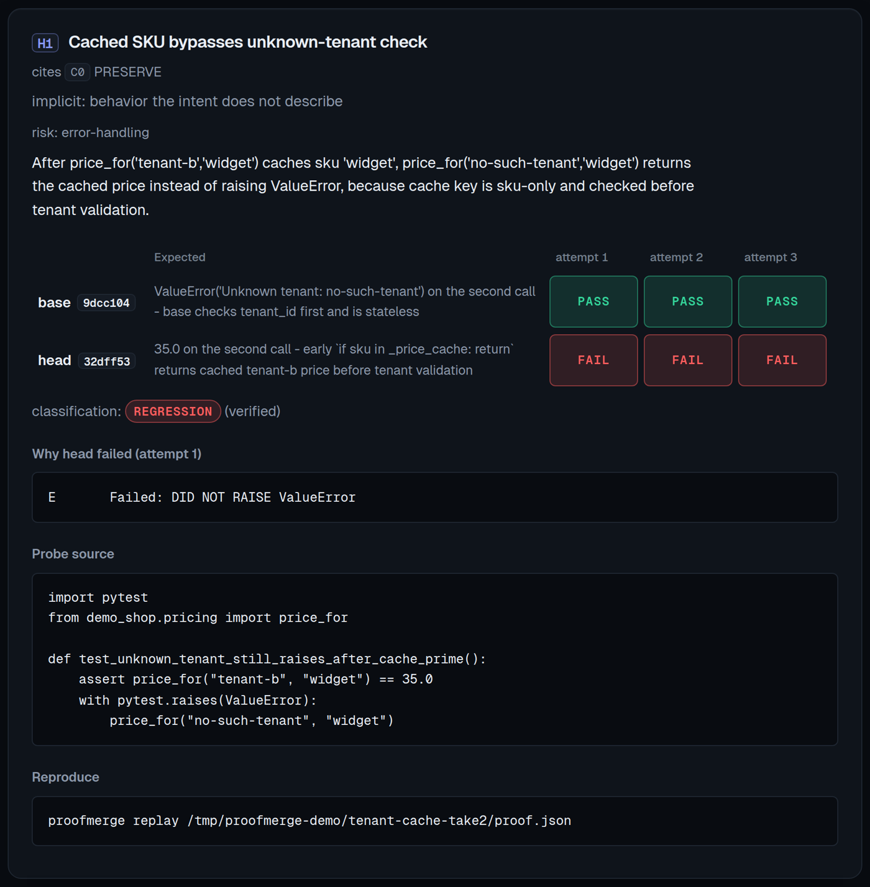
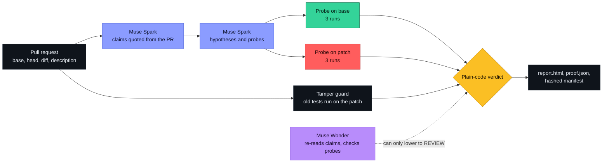
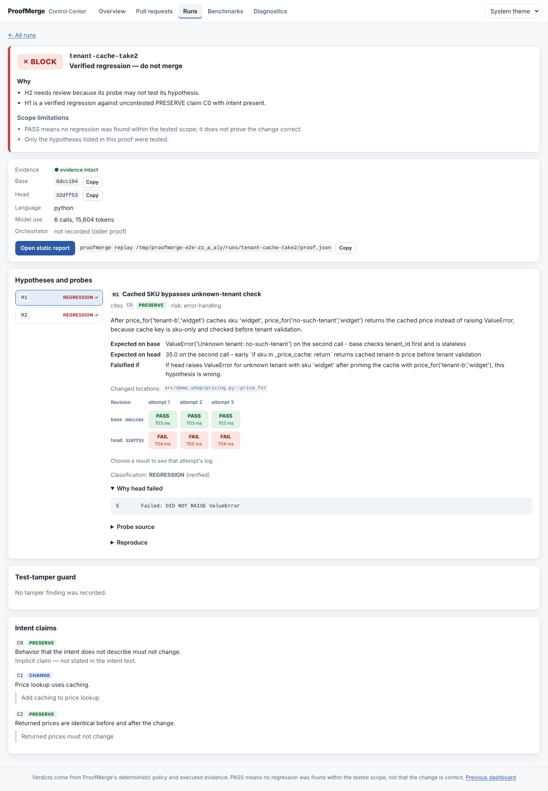

<picture>
  <source media="(prefers-color-scheme: dark)" srcset="docs/assets/hero-dark.png">
  
</picture>

<p align="center">
  <a href="https://github.com/imthi16/proofmerge/actions/workflows/ci.yml"></a>
  
  
  
  
  
</p>

<p align="center">
  <a href="#use-it-without-a-terminal"><b>Use the app</b></a>&emsp;
  <a href="#what-a-run-looks-like"><b>See a run</b></a>&emsp;
  <a href="#how-a-verdict-is-reached"><b>How it decides</b></a>&emsp;
  <a href="#results"><b>Results</b></a>&emsp;
  <a href="#get-started"><b>Get started</b></a>&emsp;
  <a href="#in-your-coding-agent-the-agent-skill"><b>Agent Skill</b></a>&emsp;
  <a href="#safety-and-limits"><b>Limits</b></a>
</p>

ProofMerge checks a pull request written by an AI coding agent. It doesn't ask
another model whether the code looks good. It writes a test that passes on the
original code, runs it three times on the original and three times on the
patch, and lets plain code decide what the results mean.

Built solo for the Meta Global AI Developer Hackathon 2026, Indie Developer
track, theme "Push the Frontier". Muse Spark 1.3 writes the hypotheses and
tests; Muse Wonder 1.0 checks Spark's work. [MIT licensed](LICENSE).

> [!NOTE]
> ProofMerge is meant for repositories you own and for synthetic fixtures. A
> PASS means no regression was found within the tested scope. It does not prove
> the change correct or secure.

## Use it without a terminal



`proofmerge app` opens ProofMerge in your browser and does everything the
command line does. It was built for people who never open a terminal:

1. **Install.** On Windows, download the
   [installer](installer/windows/Install-ProofMerge.cmd) and double-click it. It
   sets up Python, Git, the GitHub CLI and Docker Desktop if they are missing,
   asking before each one.
2. **Set up once.** The Setup page checks Docker, builds the sandbox image, takes
   your model key (kept in memory, never written to disk) and signs you in to
   GitHub with a one-time code.
3. **Check a change.** Pick one of your GitHub repositories and an open pull
   request and press **Verify this PR**, or pick a folder on your computer and
   two branches and press **Check this change**. The page shows each step as it happens, then the
   verdict, the reasons and the full report.



**Sign in to GitHub without a terminal.** The page shows a one-time code; enter
it at github.com/login/device. The GitHub CLI keeps the sign-in in the system
credential store, so ProofMerge never sees the token. Downloading a repository
never runs its code; only the sandbox does.

The app also lists risks without running anything, writes tests without a
verdict, re-checks a run's evidence hashes and re-runs its tests. Runs are saved
in `~/ProofMerge/runs`, repositories in `~/ProofMerge/repos`.

### Walkthrough video

<a href="docs/assets/walkthrough.mp4"></a>

[Watch the full walkthrough](docs/assets/walkthrough.mp4) (4 min 20 s, no
sound, captions on screen). It was recorded before the app's 2026-11-03 visual
refresh, so the colours and the Home layout differ from the screenshots above. It covers every use case in order: setup, GitHub
sign-in, picking a repository, verifying a pull request, the evidence and the
report, checking a local branch, runs and benchmarks, then the terminal
(`verify`, `replay`) and the Agent Skill.

> [!NOTE]
> The walkthrough uses a simulated outside world, so it shows no real account or
> key: the GitHub account, its repositories and pull requests, and the progress of
> each check are faked, and no model is called. The verdicts, reports and evidence
> are the real recorded demo run in `demo/runs/2026-10-29`, and the terminal
> output is real. For real runs on GitHub, see the three pull requests in
> [proofmerge-demo-shop](https://github.com/imthi16/proofmerge-demo-shop/pulls?q=is%3Apr).

## What a run looks like

```bash
proofmerge verify demo/.build/demo-shop --base main \
  --head candidate/tenant-cache-regression \
  --intent-file demo/candidates/tenant-cache-regression/intent.md \
  --evidence-dir /tmp/proofmerge-demo/tenant-cache-take2
```

Real output from that run (exit code 2):

```text
verdict: BLOCK
H2 needs review because its probe may not test its hypothesis.
H1 is a verified regression against uncontested PRESERVE claim C0 with intent present.
report: /tmp/proofmerge-demo/tenant-cache-take2/report.html
calls=6 tokens: prompt=5702 completion=9902
```

(Token totals from `demo/runs/2026-10-29/tenant-cache-take2/proof.json`.)

<table>
  <tr>
    <td width="56%" valign="top"></td>
    <td valign="top">
    <b>One card per hypothesis.</b> This is H1, unedited. On the patch, an
    unknown tenant gets a cached price instead of an error.<br><br>
    In the same run, Muse Wonder flagged H2: its probe caught a cross-tenant
    price leak, but it doesn't test the "stale cache" behavior H2 describes, so
    H2 counts only as REVIEW. <a href="docs/assets/report-full.png">Whole report</a>.<br><br>
    The report is one static HTML file, with no server, no JavaScript and
    nothing loaded from the network.
    </td>
  </tr>
</table>

Every probe, log and command in the run is hashed. `proofmerge replay
<proof.json>` checks that nothing changed after the run and recomputes the
findings and the verdict from the recorded executions with the same plain-code
policy, so an edited verdict fails even if the manifest was rewritten too. With
`--rerun --repo <repo>` it runs every probe again in Docker and reports whether
each recorded outcome reproduces. Recomputation shows the verdict follows from
the records; only `--rerun` checks the records themselves.

## The problem

The repo ships a small demo shop and three pull requests an AI agent might open.
The shop's own test suite passes on all three. Two of them are broken.

| | Pull request | What it says | What it really does |
|---|---|---|---|
|  | `tenant-cache-regression` | "Add caching to price lookup for speed. Returned prices must not change." | Caches prices by product only. A tenant can get another tenant's price, and an unknown tenant gets a price instead of an error. |
|  | `test-tamper` | "Refactor discount calculation for readability. Keep the existing results." | Stops giving the discount at exactly 100, then edits the test that checked it, so the suite stays green. |
|  | `intended-change` | "Raise the bulk discount threshold from 100 to 150. Update the implementation and existing tests…" | Exactly that. The old test fails because the rule changed on purpose. It must not be blocked. |

Here is the whole first bug. The cache key is the product alone:

```diff
+_price_cache: dict[str, float] = {}
+
 def price_for(tenant_id: str, sku: str) -> float:
+    if sku in _price_cache:
+        return _price_cache[sku]
     ...
-    return table[sku]
+    price = table[sku]
+    _price_cache[sku] = price
+    return price
```

A green CI badge would wave all three through. A rule like "an old test now
fails, so block it" would wrongly block the third. ProofMerge has to tell them
apart. On real runs of all three, it gave BLOCK, BLOCK and REVIEW.

## How a verdict is reached



1. Muse Spark reads the PR description and lists what it promises to change and
   to keep. A claim is kept only if it quotes the PR text exactly.
2. Spark proposes how the patch could break one of those promises, and writes a
   small test for each guess. A test counts only if it passes on the original
   code.
3. Each test runs three times on each version, in a Docker container with no
   network, no host secrets and read-only code.
4. Tests the PR deleted, skipped or weakened are run in their original form
   against the patch.
5. Muse Wonder independently re-reads each claim and checks whether each test
   really tests its guess. It can only move a result toward REVIEW.
6. Plain code turns the results into a verdict and writes the evidence.

How results map to a decision:

| Base | Patch | Meaning |
|---|---|---|
|  pass 3/3 |  fail 3/3 | The patch introduced a failure. **BLOCK**, unless the PR said this change is intended. |
|  fail |  pass | Possibly a fix. Not a regression. |
|  fail |  fail | The problem was already there. Not a regression. |
|  pass |  pass | This test found nothing. That is not proof of correctness. |
|  error, timeout or mixed | any | **REVIEW** until resolved. |

| Verdict | When |
|---|---|
|  | A reproducible failure the patch introduced, or an original test that now fails while the PR claims no change. |
|  | Anything uncertain: a flaky or broken test, an API error, a change the PR says is intended, a test Wonder doubts. The default when in doubt. |
|  | Every check ran and none found a regression: "no regression found within the tested scope". |

> [!IMPORTANT]
> A model can push a verdict toward REVIEW. It can never push one to BLOCK or
> PASS. Exit codes, commands and commit hashes are the evidence; a model's
> confidence is not.

<details>
<summary><b>The one rule that looks like an exception: a regression that cites a CHANGE claim</b></summary>
<br>

When a verified regression (base pass 3/3, patch fail 3/3) is tied to a claim
the PR marks as a change, three things can happen:

| Muse Wonder | Verdict for that finding |
|---|---|
| did not run (API error, budget, schema failure) | REVIEW: ProofMerge cannot tell whether the change is intended |
| ran and confirmed that a CHANGE claim in the PR explains the failure | REVIEW: possibly the intended change |
| ran and found no CHANGE claim that explains it | judged against "everything else stays the same" (C0), so it can be BLOCK |

The BLOCK still rests on the base and patch runs, decided in code. Wonder's
output can only grant the "intended change" exemption, which moves a result to
REVIEW. REVIEW when Wonder is missing is a fail-safe, not a model decision.
Without this rule, one vague sentence such as "simplify the pricing code" would
excuse any regression in that area. See `src/proofmerge/verdict.py` and
`tests/test_verdict.py`.

</details>

## Results

Twenty-eight synthetic pull requests on one small fixture, 16 faulty and 12
safe. This is a smoke benchmark, not an accuracy claim: the intents name the
changed function. Run 3, on main `5df3735`. Rules were frozen before batch 3
was written, so the held-out slice is the clean number. Counts come from
[run 3 results.json](bench/results/2026-10-30-run3/results.json).

| Label and slice | BLOCK | REVIEW | PASS | ERROR |
|---|---:|---:|---:|---:|
| Faulty, all (16) | **14** | 2 | **0** | 0 |
| Safe, all (12) | 1 | 6 | 5 | 0 |
| Faulty, held out (8) | **6** | 2 | **0** | 0 |
| Safe, held out (7) | **0** | 4 | 3 | 0 |

121 model calls, 0 errors. PASS means no regression found within tested scope.

- No faulty case was passed.
- One safe case, `newsletter-promo-fix` (not held out), is a false BLOCK, as in
  run 2. The probe found a real behavior change: customers on the old field
  lose a promotion. The PR's description doesn't say that explicitly, and the
  rule for "this change is intended" is strict on purpose, so a vague sentence
  can't hide a regression.

The [baseline results](bench/results/2026-10-30-baselines/results.json) cover
the same candidates:

| Method | Faulty BLOCK / total | Safe BLOCK / total | Model calls |
|---|---:|---:|---:|
| Base tests run on head in Docker (A) | 1 / 16 | 3 / 12 | 0 |
| One-shot Spark opinion (B) | 16 / 16 | 0 / 12 | 28 |
| ProofMerge ([run 3](bench/results/2026-10-30-run3)) | 14 / 16 | 1 / 12 | 121 |

Baseline B scored every candidate correctly, so this bench does not separate
the approaches on accuracy. ProofMerge's difference is evidence: a BLOCK is
backed by a Spark-written probe that passes on base 3/3 and fails on head 3/3,
recorded and replayable with `proofmerge replay`. Baseline B gives an
unverifiable opinion with no repro. See [the detailed results](bench/results/README.md)
and [baseline bundles](bench/results/2026-10-30-baselines).

History: [run 2](bench/results/2026-10-29-run2) followed rule changes and was
not a clean held-out evaluation.

## Get started

### Windows, no terminal at all

Open [installer/windows/Install-ProofMerge.cmd](installer/windows/Install-ProofMerge.cmd),
press **Download raw file**, and double-click the downloaded file. If Windows
says it protected your PC, choose **More info**, then **Run anyway**.

The installer finds or offers to install Python 3.11+, Git, the GitHub CLI
(optional, for signing in to GitHub) and Docker Desktop through winget; you
accept each license yourself. It installs ProofMerge for your user only in
`%LOCALAPPDATA%\ProofMerge`, adds ProofMerge and Uninstall ProofMerge to the
Start menu and ProofMerge to the desktop, then opens it. Run it again to update.
Uninstalling keeps your checks in `%USERPROFILE%\ProofMerge`.

### Linux, one script

```bash
curl -fsSLO https://raw.githubusercontent.com/imthi16/proofmerge/main/installer/linux/install-proofmerge.sh
sh install-proofmerge.sh
```

It checks for Python 3.11+, Git, the GitHub CLI (optional) and Docker, and prints
the install command for anything missing; it never uses sudo. It installs
ProofMerge for your user only in `~/.local/share/proofmerge`, adds ProofMerge and
Uninstall ProofMerge to the applications menu, then opens it. Run it again to
update. Uninstalling asks before it removes anything and keeps your checks in `~/ProofMerge`.

### macOS, Linux, or Windows with Python

You need Python 3.11 or newer, Git and Docker.

```bash
uv tool install git+https://github.com/imthi16/proofmerge
proofmerge app                       # the browser app; or carry on in the terminal:
proofmerge setup                     # builds the Docker runner image
export MODEL_API_KEY=...             # your Meta developer key; never commit it
```

Installing puts a `proofmerge-app` launcher in the Python Scripts folder; on
Windows that is a `.exe` you can pin to the Start menu. Keep its window open
while you use the app, or press **Quit ProofMerge**.

### Run the demo

The demo files need a clone; the tool itself does not.

```bash
git clone https://github.com/imthi16/proofmerge
cd proofmerge
python3 demo/build_demo_repo.py      # creates demo/.build/demo-shop
proofmerge verify demo/.build/demo-shop \
  --base main --head candidate/tenant-cache-regression \
  --intent-file demo/candidates/tenant-cache-regression/intent.md \
  --evidence-dir /tmp/proofmerge-evidence
```

`verify` exits 0 for PASS and REVIEW, 2 for BLOCK and 1 if it could not run.

### In your coding agent: the Agent Skill

<picture>
  <source media="(prefers-color-scheme: dark)" srcset="docs/assets/agent-skill-dark.png">
  
</picture>

[skills/proofmerge/SKILL.md](skills/proofmerge/SKILL.md) is an Agent Skill. It
tells a coding agent to commit its change, write down what the change should do
before it sees a verdict, run `proofmerge verify` on its own branch, and report
the verdict word for word before it calls the work done. A BLOCK sends the
agent back to fix the code, never to edit the tests or the evidence; a PASS is
reported as "no regression found within the tested scope", never as proven.

This repository is also a plugin marketplace, so the skill installs and updates
like any other plugin:

| Agent | Install |
|---|---|
| **Claude Code** | `/plugin marketplace add imthi16/proofmerge`, then `/plugin install proofmerge@proofmerge` |
| **Codex CLI** | `codex plugin marketplace add imthi16/proofmerge`, then `codex plugin add proofmerge@proofmerge` |
| **Any agent that reads Agent Skills** | copy [`skills/proofmerge`](skills/proofmerge) into that agent's skills folder |

For a plain copy without a clone, for example into Claude Code's personal
skills:

```bash
mkdir -p ~/.claude/skills/proofmerge
curl -fsSL https://raw.githubusercontent.com/imthi16/proofmerge/main/skills/proofmerge/SKILL.md \
  -o ~/.claude/skills/proofmerge/SKILL.md
```

The skill needs `proofmerge` installed and `MODEL_API_KEY` set in the agent's
environment; it tells the agent never to ask for the key in chat. It asks before
a third run on the same task (each run makes at most 19 model calls) and before
running on a repository you don't own.

<details>
<summary><b>On every pull request: the GitHub Action</b></summary>
<br>

Add the workflow from [docs/github-action.md](docs/github-action.md). It runs
ProofMerge on each PR, uploads the evidence and comments with the verdict.

It runs on three agent-style PRs in the public
[proofmerge-demo-shop](https://github.com/imthi16/proofmerge-demo-shop) repository,
and each comment links its evidence:

| Pull request | Verdict | Why | Model calls |
|---|---|---|---|
| [#1 Add caching to price lookup](https://github.com/imthi16/proofmerge-demo-shop/pull/1) | BLOCK | Spark's probe passes on base and fails on the PR, against a claim the intent does not contest | 6 |
| [#2 Refactor discount calculation for readability](https://github.com/imthi16/proofmerge-demo-shop/pull/2) | BLOCK | A verified regression, and the PR edits tests that now fail, with no CHANGE claim to explain it | 5 |
| [#3 Raise the bulk discount threshold to 150](https://github.com/imthi16/proofmerge-demo-shop/pull/3) | REVIEW | Changed tests fail, but the PR's description asks for that change | 3 |

```yaml
name: ProofMerge
on: pull_request
permissions:
  contents: read
  pull-requests: write
jobs:
  verify:
    runs-on: ubuntu-latest
    steps:
      - uses: actions/checkout@v4
        with:
          fetch-depth: 0
          persist-credentials: false
      - uses: imthi16/proofmerge@main
        with:
          model-api-key: ${{ secrets.MODEL_API_KEY }}
          fail-on: block
          python-version: '3.13'
```

</details>


<details>
<summary><b>Without a Meta API key</b></summary>
<br>

In the app, open **Setup** and choose the **AI model**:

- **Meta Muse** (the default): Muse Spark and Muse Wonder with your Meta key.
- **Claude plan**: the Pro or Max plan Claude Code is signed in to on your
  computer; no API key. ProofMerge calls Claude Code with every tool switched
  off.
- **Other API**: any OpenAI-compatible address (or a model on your own computer
  at `http://localhost`), a model for writing the tests, a model for checking
  them, and that service's key.

The choice is saved in `~/ProofMerge/settings.json`; the key never is. In a
terminal the same choices are environment variables (`PROOFMERGE_BACKEND=claude-cli`,
`PROOFMERGE_BASE_URL`, `PROOFMERGE_SPARK_MODEL`, `PROOFMERGE_WONDER_MODEL`). The
verdict rules are the same for every model; the results above were measured with
Meta Muse only. Codex plans are not offered: Codex's shell tool cannot be turned
off, so text in a repository could make it read files on your computer. See
[docs/model-backends.md](docs/model-backends.md) for the settings, the
training-data warning for contributor models and which agent CLIs were checked.

</details>

<details>
<summary><b>The Control Center dashboard</b></summary>
<br>

```bash
proofmerge dashboard bench/results       # or any folder of evidence runs
```

It opens the Control Center on `http://127.0.0.1:8765/`: an overview of recorded
verdicts and evidence integrity, a filterable and paged list of every run under the
folder, and an evidence explorer per run (verdict reasons, intent claims, each
hypothesis with its base/head attempts and logs, why head failed, the probe source,
tamper findings, model use, orchestration, the replay command and the static
report). A Benchmarks page compares each `results.json` with its labels, the
held-out slice and the baselines; a Diagnostics page says whether Docker, the
runner image, `gh`, the model key (present or not, never its value) and LangGraph
are ready. Light, dark and system themes; it works at phone width. The app from
`proofmerge app` is served beside it at `/app/`. See
[docs/control-center.md](docs/control-center.md).



Add `--repo path/to/repo` (a clone with a GitHub remote and `gh` signed in) for a
Pull requests tab: each PR shows the ProofMerge verdict for its current head
commit, if a run exists, and an open PR can be verified from the page. That
fetches it into `refs/proofmerge/` without touching your branches and runs
`proofmerge verify` with the PR description as the intent, after a confirmation
that names the cost (up to 19 model calls) and the trust requirement. The page
then follows the run live: each pipeline stage as it starts, retries, finishes or
is skipped, streamed over server-sent events. The verdict appears only after the
deterministic verdict stage has run.

The server answers on 127.0.0.1 only. Every request that starts work needs a
per-session token and a same-origin request.

</details>

<details>
<summary><b>Working on ProofMerge itself</b></summary>
<br>

```bash
python3 -m venv .venv && source .venv/bin/activate
pip install -e ".[dev]"
pytest -q                            # offline: no network, no API key needed
ruff check src tests
python3 demo/check_demo.py           # compares the demo branches with the hand-written ground truth
```

</details>

## What works today

| Part | State |
|---|---|
| `proofmerge verify`, end to end | Built and tested; real runs on the demo and the benchmark |
| Intent contract: claims must quote the PR text | Built and tested |
| Spark hypotheses and probes that must pass on base first | Built and tested |
| Docker runs: no network, no host secrets, read-only code, 3 runs per version | Built and tested |
| Test-tamper guard: original tests run on the patch | Built and tested |
| Muse Wonder cross-check of claims and probes | Built and tested |
| Plain-code verdict, `report.html`, `proof.json`, hashed manifest, `replay` | Built and tested |
| `replay` recomputes findings and the verdict from the recorded evidence (proofs from T56 on) | Built and tested; an edited and resealed verdict or outcome fails; older proofs get a notice |
| `replay --rerun`: experiments re-run in Docker | Built; demo run reproduced |
| Scope receipt: what a run checked (hypotheses, probes, attempts, changed tests), in `report.html` and `verify` output | Built and tested |
| `proofmerge app` (`/app/`): every command from the browser (verify, risks only, probes only, evidence check, re-run, setup, model check) | Built and tested offline with fakes; a real `verify` on the demo shop was started and finished from the page in headless Chrome with the model endpoint pointed at a closed local port (REVIEW, as expected); not yet run with a real key from the page, and not yet run on Windows |
| GitHub sign-in, repository and pull request picker in the app | Built and tested offline; a real `gh` sign-in was started and cancelled, and with a real account the page listed repositories, cloned one and listed its 50 pull requests; a full sign-in by a person and a run on Windows are not done yet |
| Linux installer (`installer/linux/install-proofmerge.sh`) | Built and run on Ubuntu in a clean home folder: installed from GitHub, the menu entry's command started the app (`/app/` answered 200), a second run updated it, the uninstaller removed it and kept `~/ProofMerge`; other distributions not tried |
| Windows installer (`installer/windows/Install-ProofMerge.cmd`) | Built; its structure and safety rules are checked by tests on Linux; not yet run on a Windows machine |
| One-command install and `proofmerge setup` | Built; checked from a fresh clone |
| GitHub Action | Built and tested; ran on three PRs in [proofmerge-demo-shop](https://github.com/imthi16/proofmerge-demo-shop/pulls?q=is%3Apr) (BLOCK, BLOCK, REVIEW), each with a verdict comment and an evidence artifact |
| Benchmark runner, three recorded runs and two baselines | Built; results above |
| Other languages through `.proofmerge.toml` (Go demo) | Built and tested; one real `verify` on the synthetic Go demo gave BLOCK (Spark-written Go probe, base PASS 3/3, head FAIL 3/3), bundle in `demo/runs/2026-10-30-go`; no tamper guard for other languages; see [docs/languages.md](docs/languages.md) |
| JavaScript and TypeScript repositories set up automatically (npm `package-lock.json`, no config) | Built and tested; a real `verify` on the synthetic TypeScript demo gave BLOCK (H1: Spark-written `node:test` probe, base PASS 3/3, head FAIL 3/3, while the repo's own vitest suite passes on both), bundle in `demo/runs/2026-11-02-ts`; npm only; no tamper guard; code that needs a browser is not tested; see [docs/languages.md](docs/languages.md) |
| Python monorepo import paths and optional hashed installs | Built and tested offline. `[python]` in the base commit's `.proofmerge.toml` sets the import root; head config is ignored. Install is opt-in from the base lockfile. Import and install failures are REVIEW, never PASS or BLOCK. See [docs/python-projects.md](docs/python-projects.md) |
| Other model backends: OpenAI-compatible endpoints, Claude Code CLI on a plan, chosen on the app's Setup page | Built and tested offline; one real Claude Code call checked; the Setup choice checked in a browser; no full `verify` run on them yet |
| `proofmerge dashboard` (Control Center): runs, evidence integrity, benchmarks, pull requests | Built and tested offline; checked in a browser on `bench/results` at desktop, phone width and dark mode; PR list read from this repository with `gh`; verify-from-the-page tested with fakes only |
| LangGraph orchestrator (`--orchestrator langgraph`): same stages, same plain-code verdict, retries of transient model failures only | Built and tested offline and with real Docker; parity with the default loop checked on nine scenarios; no real Meta API run on it yet; see [docs/orchestration.md](docs/orchestration.md) |
| Agent Skill for coding agents, packaged as Claude Code and Codex plugins | Built; commands and options checked offline against the CLI; manifests pass `claude plugin validate`, and `codex plugin add` installed it into an isolated Codex home; not yet used by an agent on a real task |
| PASS strength beyond the receipt (for example mutation checks) | Planned |

Each row has a dated entry with its real check results in
[BUILDLOG.md](BUILDLOG.md).

## Safety and limits

- Repository code, diffs, PR text and model-written tests are treated as
  untrusted. Model-written shell commands are never run on your machine.
- Git, Docker and the GitHub CLI are called with argument lists, never through a
  shell.
- The API key is read from the `MODEL_API_KEY` environment variable, or typed
  into the app and kept in memory. It is never written to logs, reports or the
  sandbox. The GitHub token stays inside the GitHub CLI.
- Hashes show that a file changed after the run. They are not signatures and
  don't prove who produced the evidence.
- A model can still guess wrong. Spark may cite a different claim from one run
  to the next, which can change a verdict between BLOCK and REVIEW. The recorded
  runs in `bench/results/` show this.
- By default ProofMerge calls Meta's Muse Spark 1.3 and Muse Wonder 1.0 through
  the Meta API, and the benchmark numbers hold for these two models only. Other
  OpenAI-compatible endpoints and the Claude Code CLI can be used instead
  ([docs/model-backends.md](docs/model-backends.md)); with them the verdict rules
  are the same, but probe quality is untested. Models that may train on prompts
  are refused unless you opt in.

> [!WARNING]
> ProofMerge makes no safety promise for running untrusted external code.
> Isolated runs have been checked on the bundled fixtures only.

<details>
<summary><b>Repository layout</b></summary>

```text
src/proofmerge/
  cli.py         command-line entry point, including `proofmerge app`
  pipeline.py    runs every stage of verify and writes the evidence
  context.py     reads base/head commits and the diff from Git
  meta.py        the model client: Meta API by default, or another backend
  cli_backend.py model calls through a signed-in CLI (Claude Code only)
  intent.py      intent claims, kept only if their quote is in the PR text
  hypotheses.py  Spark's failure hypotheses, checked against the diff
  probes.py      Spark probe drafts, base validation and repeated runs
  sandbox.py     runs a probe on base and head inside Docker
  tamper.py      finds tests the PR deleted, skipped or weakened, and reruns them
  findings.py    turns repeated runs into findings
  wonder.py      Muse Wonder's cross-checks
  verdict.py     the plain-code verdict rules
  evidence.py    the proof.json format
  manifest.py    evidence hashes and replay checks
  rederive.py    recomputes findings and the verdict from a proof for replay
  report.py      renders proof.json as report.html
  dashboard.py   the local server for the app and the Control Center, and its trust checks
  dashboard_jobs.py    the app's jobs: every CLI command started from the page
  dashboard_github.py  GitHub sign-in, repository list and clone through the GitHub CLI
  dashboard_prs.py     pull requests: list with gh, verify on request
  dashboard_api.py     the typed /api/v1 data; dashboard_models.py its response models
  dashboard_events.py  verification progress events and the SSE stream
  dashboard_static/    the built Control Center (app/) and the browser app (legacy/)
  telemetry.py   opt-in OpenTelemetry spans for verify (PROOFMERGE_OTEL=1)
  prompts/       the instructions given to Muse Spark and Muse Wonder
ui/              Control Center source (React + TypeScript + Vite); see docs/control-center.md
installer/windows/  the double-click Windows installer
installer/linux/    the one-script Linux installer
tests/           offline tests; models are replaced with fakes
docker/runner/   the image probes run in (Python + pytest only)
demo/            the demo shop, its three PRs and hand-written ground truth
bench/           28 benchmark PRs, ground truth, runner and results
action.yml       the GitHub Action
skills/          the Agent Skill; .claude-plugin/, .codex-plugin/ and .agents/plugins/ make this repo a plugin marketplace for Claude Code and Codex
docs/            spec, plan, Meta API notes, model backends, prior art, Action guide
BUILDLOG.md      what was actually built, and when
ORIGINALITY.md   what counts as new work for this hackathon
```

</details>

## How it was built

Muse Spark and Muse Wonder are the only runtime models. AI coding assistants
were used as development tools while building ProofMerge; every change was
reviewed and checked by running the tests. [ORIGINALITY.md](ORIGINALITY.md)
lists what was built during the event window, and
[docs/PRIOR_ART.md](docs/PRIOR_ART.md) covers related work, including ORION,
the closest prior approach.
