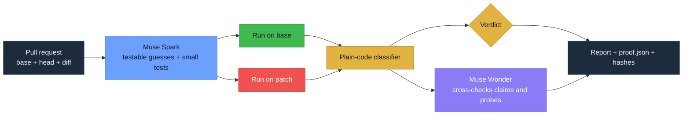

<p align="center">
  
</p>

<p align="center">
  
  
  
  
  
</p>

ProofMerge checks a pull request written by an AI coding agent. It doesn't
ask a second AI whether the code "looks good". It tries to find a test that
passes on the original code and fails on the patch, runs that test on both
versions, and reports what actually happened.

Built solo for the Meta Global AI Developer Hackathon 2026.
Track: Indie Developer · Theme: Push the Frontier.
Runtime intelligence: Meta Muse Spark 1.3; Muse Wonder 1.0 cross-checks claims and probes.
License: [MIT](LICENSE).

> [!IMPORTANT]
> **Early build.** The parts marked 🟢 under [What works today](#what-works-today)
> are built and tested. ProofMerge is for repositories you own or synthetic fixtures.
> A PASS means no regression was found within the tested scope; it does not prove the
> change correct or secure.

## 📦 Install

You need Python 3.11 or newer, Git and Docker.

```bash
uv tool install git+https://github.com/imthi16/proofmerge
proofmerge setup          # builds the Docker runner image
```

Set your Meta developer key:

```bash
export MODEL_API_KEY=...  # never commit this
```

Run it on the bundled demo (the demo files need a clone; the tool itself does not):

```bash
git clone https://github.com/imthi16/proofmerge
cd proofmerge
python demo/build_demo_repo.py
proofmerge verify demo/.build/demo-shop \
  --base main --head candidate/tenant-cache-regression \
  --intent-file demo/candidates/tenant-cache-regression/intent.md \
  --evidence-dir /tmp/proofmerge-evidence
```

## 🔍 The problem in one table

The repo ships a small demo shop and three pull requests an AI agent might
open. The shop's own test suite passes on all three. Two of them are broken.

This is real output from `python demo/check_demo.py`:

```text
branch                              existing suite  ground-truth test  base tests on head
--------------------------------------------------------------------------------------
main                                PASS            PASS               n/a
candidate/intended-change           PASS            n/a                FAIL
candidate/tenant-cache-regression   PASS            FAIL               PASS
candidate/test-tamper               PASS            FAIL               FAIL
```

| | Pull request | What it claims | What it really does |
|---|---|---|---|
| 🔴 | `tenant-cache-regression` | "Add caching to price lookup for speed. Returned prices must not change." | Caches prices by product only, so one tenant can be charged another tenant's price. |
| 🔴 | `test-tamper` | "Refactor discount calculation for readability. No behavior change intended." | Stops giving the discount at exactly 100, then deletes the test that checked it, so the suite stays green. |
| 🟢 | `intended-change` | "Raise the bulk discount threshold from 100 to 150." | Exactly that. The old test fails because the rule changed on purpose. It must not be blocked. |

Here is the whole first bug. The cache key is the product alone, so the first
tenant to look up a price sets it for everyone:

```diff
+_price_cache: dict[str, float] = {}
+
 def price_for(tenant_id: str, sku: str) -> float:
+    if sku in _price_cache:
+        return _price_cache[sku]
     ...
-    return table[sku]
+    price = table[sku]
+    _price_cache[sku] = price
+    return price
```

A green CI badge would wave all three through. A naive "old test now fails,
so block it" rule would wrongly block the third one. ProofMerge has to tell
them apart.

> [!NOTE]
> The ground-truth tests in `demo/ground_truth/` are written by hand and are
> never shown to a model. They are only used to score ProofMerge.

## ⚙️ How a verdict is reached

This is the end-to-end workflow. Implemented parts are listed below.



1. Read the base and head commits and the diff between them.
2. Ask Muse Spark for specific, testable guesses about what the patch could
   break, each with a small test that would show it.
3. Run each test on the base version and on the patched version, separately
   and in isolation.
4. Classify the results with plain code, not a model.
5. Ask Muse Wonder to independently cross-check each claim and probe. It can
   only move a verdict toward REVIEW.
6. Write a report, a `proof.json` file and hashes of every file used.

How results map to a decision:

| Base | Patch | Meaning |
|---|---|---|
| 🟢 pass | 🔴 fail | The patch introduced a failure. **BLOCK** if it repeats. |
| 🔴 fail | 🟢 pass | Possibly a fix. Not a regression. |
| 🔴 fail | 🔴 fail | The problem was already there. Not a regression. |
| 🟢 pass | 🟢 pass | This test found nothing. That is not proof of correctness. |
| 🟡 error, timeout or flaky | any | **REVIEW** until resolved. |

The three verdicts:

| Verdict | When |
|---|---|
|  | At least one reproducible failure that the patch introduced. |
|  | Anything uncertain: a failed setup, a flaky test, an API error, too little context. The default when in doubt. |
|  | Every check ran and none found a regression. Reported as "no regression found within the tested scope", never as "proven correct". |

> [!IMPORTANT]
> A model can push a verdict toward REVIEW. It can never push one to BLOCK or
> PASS. Exit codes, commands and commit hashes are the evidence; a model's
> confidence is not.

## 🧾 The report

`proofmerge report` turns a run's `proof.json` into one static `report.html`: no
server, no JavaScript, nothing loaded from the network. Each hypothesis gets one card with the PR sentence it
relies on, the same probe run 3 times on each commit, and why head failed.

<picture>
  <source media="(prefers-color-scheme: dark)" srcset="docs/assets/report-card-dark.png">
  
</picture>

> [!NOTE]
> From a real run on the demo's tenant-cache PR (Muse Spark + Muse Wonder, Docker): the probe was written by Spark, base PASS 3/3, head FAIL 3/3; on the patch an unknown tenant gets a cached price instead of an error.
> [Whole page](docs/assets/report-full-real-light.png).

Render it yourself:

```bash
proofmerge report tests/fixtures/sample_proof_block.json --out report.html
```

## ✅ What works today

| | Part | State | BUILDLOG entry |
|---|---|---|---|
| 🟢 | CLI skeleton (`proofmerge version`, `proofmerge smoke`) | Built, tested | Day 2 gate (2026-10-27) |
| 🟢 | Git context: base/head SHAs, changed files, diff and its SHA-256 | Built, tested | Day 3 gate (2026-10-28) |
| 🟢 | Meta API client: schema-checked JSON replies, a hard cap on calls, refuses `-contributor` models, never logs the key | Built, tested, one real Spark call made | Day 2 gate (2026-10-27) |
| 🟢 | Demo shop with three candidate PRs and hidden ground truth | Built, checked | Day 2 gate; T17 demo recheck |
| 🟢 | Intent contract: Spark's claims are kept only if they quote the PR text exactly | Built, tested, real Spark runs | Day 3 gate |
| 🟢 | Spark hypotheses, each tied to one claim (`proofmerge hypotheses`) | Built, tested, real Spark runs | Day 3 gate; T7b |
| 🟢 | Isolated base/head runs in Docker: no network, no host secrets, read-only code, 3 attempts each | Built, tested; demo gives base PASS 3/3, head FAIL 3/3 | T14 |
| 🟢 | Test-tamper check: deleted, skipped, xfailed or weakened tests in the diff; affected base tests run on head | Built, tested; no verdict decision | T8 and lead review; T16 |
| 🟢 | `proof.json` format and `report.html` (`proofmerge report`) | Built, tested on sample proofs | T13; T13b |
| 🟢 | Benchmark batches 1 and 2: 12 faulty and 8 safe PRs with hidden ground truth | Built, checked; fixtures only, no accuracy result | T11; T17 |
| 🟢 | Spark-written probes that must pass on base before head counts (`proofmerge probe`) | Built, tested, real Spark/Docker runs | T18 and Codex review fixes |
| 🟢 | Evidence manifest and `proofmerge replay` | Built, tested; checks hashes without re-running experiments | T21 |
| 🟢 | Evidence normalizer: repeated base/head outcomes mapped to findings | Built, tested; no final verdict | T25 |
| 🟢 | Deterministic verdict engine | Built, tested | T24 deterministic verdict engine (2026-10-29) |
| 🟢 | End-to-end `proofmerge verify` | Built, tested; real demo run produced BLOCK | T23 end-to-end verification (2026-10-29) |
| 🟢 | Muse Wonder cross-check | Built, tested | T30 independent cross-checks (2026-10-29) |
| 🟢 | GitHub Action that runs on every PR | Built, not yet run on GitHub | T28 GitHub composite action (2026-10-29) |
| 🟢 | One-command install and `proofmerge setup` | Built, tested | T31 Fresh install + `proofmerge setup` (2026-10-29) |
| 🟢 | Benchmark runner (`bench/run_bench.py`) | Built, tested; two real runs recorded | Benchmark run 1; Benchmark run 2 (2026-10-29) |
| ⚪ | Replay re-running experiments in Docker | Planned | No completed checks recorded |
| ⚪ | PASS strength | Planned | No completed checks recorded |

Day-by-day progress, with the real check results, is in [BUILDLOG.md](BUILDLOG.md).

## 📊 Results

20 synthetic pull requests on one small fixture (12 faulty, 8 safe); a smoke benchmark, not an accuracy claim.

| | BLOCK | REVIEW | PASS |
|---|---|---|---|
| Faulty, not held out (8) | 8 | 0 | 0 |
| Faulty, held out (4) | 4 | 0 | 0 |
| Safe, not held out (5) | 1 | 2 | 2 |
| Safe, held out (3) | 0 | 1 | 2 |

90 model calls, 78,557 prompt and 98,448 completion tokens, 0 errors.

- No faulty case was passed in either run.
- One safe case (`newsletter-promo-fix`) is a false BLOCK: the hypothesis cited the implicit claim C0, but the behavior change it found is the one the PR's CHANGE claim asks for.
- Run 2 came after fixes made in response to run 1, so it is not a clean held-out result.

Per-candidate evidence for run 2, replayable with `proofmerge replay`: [bench/results/2026-10-29-run2](bench/results/2026-10-29-run2). Run 1 and the full comparison are in [bench/results/README.md](bench/results/README.md).

## 🤖 Use it on your PRs

Add the workflow from [docs/github-action.md](docs/github-action.md) to run ProofMerge on every pull request:

```yaml
name: ProofMerge
on: pull_request
permissions:
  contents: read
  pull-requests: write
jobs:
  verify:
    runs-on: ubuntu-latest
    steps:
      - uses: actions/checkout@v4
        with:
          fetch-depth: 0
          persist-credentials: false
      - uses: imthi16/proofmerge@main
        with:
          model-api-key: ${{ secrets.MODEL_API_KEY }}
          fail-on: block
          python-version: '3.13'
```

## 🚀 Try it

You need Python 3.11 or newer and Git.

```bash
git clone https://github.com/imthi16/proofmerge
cd proofmerge
python3 -m venv .venv
source .venv/bin/activate
pip install -e ".[dev]"
```

Check the install:

```bash
proofmerge version      # proofmerge 0.1.0
pytest -q               # offline: no network, no API key needed
ruff check src tests
```

Build the demo repository, then compare its branches against the ground truth:

```bash
python demo/build_demo_repo.py   # creates demo/.build/demo-shop
python demo/check_demo.py        # prints the table shown above
```

> [!TIP]
> Run the build step first. `check_demo.py` fails with "Repo directory does not
> exist" until `demo/.build/demo-shop` has been created.

Optional: check your Meta API access. This makes exactly one real Muse Spark
call and needs your own key.

```bash
export MODEL_API_KEY=...   # your Meta developer key; never commit it
proofmerge smoke
```

## 🗂️ Repository layout

```text
src/proofmerge/
  cli.py        command-line entry point
  context.py    reads base/head commits and the diff from Git
  meta.py       the only code that talks to the Meta API
  intent.py     intent claims, kept only if their quote is in the PR text
  hypotheses.py Spark's failure hypotheses, checked against the diff
  probes.py     Spark probe drafts, base validation and repeated runs
  sandbox.py    runs a probe on base and head inside Docker
  tamper.py     finds tests the PR deleted, skipped or weakened
  evidence.py   the proof.json format
  findings.py   normalizes repeated execution outcomes into findings
  manifest.py   evidence hashes and integrity checks
  report.py     renders proof.json as report.html
  prompts/      the instructions given to Muse Spark
tests/          offline tests; models are replaced with fakes
docker/runner/  the image probes run in (Python + pytest only)
demo/
  demo-shop/    the small example project
  candidates/   the three pull requests and their descriptions
  ground_truth/ hand-written tests and expected labels, never shown to a model
bench/          more candidate PRs and their hidden ground truth, same layout
docs/
  PROJECT_SPEC.md    what ProofMerge must do, and its rules
  SPRINT_PLAN.md     the daily plan up to the deadline
  META_API_NOTES.md  Meta API facts, each with a link to the official docs
  PRIOR_ART.md       related research and tools, and how ProofMerge differs
BUILDLOG.md     what was actually built, and when
ORIGINALITY.md  what counts as new work for this hackathon
```

## 🛡️ Safety and limits

- Repository code, diffs and model-written tests are treated as untrusted.
  Model-written shell commands are never run on your machine.
- Git is called with argument lists, never through a shell.
- The API key is read from the `MODEL_API_KEY` environment variable and never
  written to logs or reports.

> [!WARNING]
> For now ProofMerge is only meant for the bundled demo project and other
> repositories you own. It makes no safety promise for running untrusted
> external code. Isolated runs have been checked on the bundled fixtures;
> broader repository support remains unverified. A PASS means the tests that ran
> found nothing. It does not mean the code is correct or secure.

## 🧰 How it was built

Muse Spark and Muse Wonder are the runtime models. Wonder independently
re-checks claims and probes; it can only move a verdict toward REVIEW.
They are the only runtime models in the design.
AI coding assistants were used as development tools while building it; every
change was reviewed and checked by running the tests. See
[ORIGINALITY.md](ORIGINALITY.md) for what was built during the event window.
