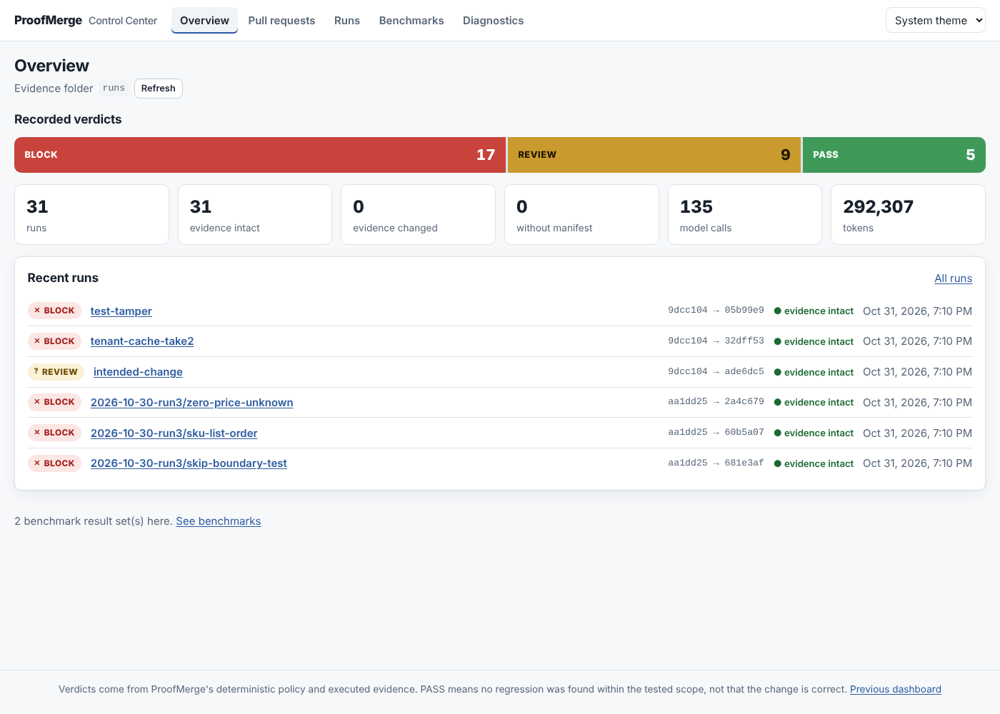
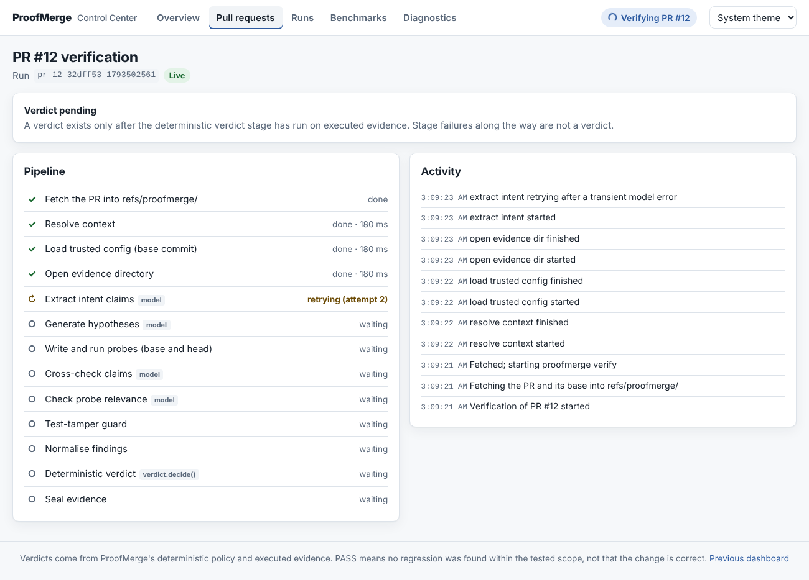

# Control Center

`proofmerge dashboard <folder> [--repo <repo>]` serves the Control Center on
`127.0.0.1`. It is a window onto evidence, not another reviewer: every decision it
shows is `proof.verdict.decision`, written by `verdict.decide()` in the
`deterministic_decide` stage. The browser never computes, scores or overrides one.



## Pages

| Route | What it shows | API |
|---|---|---|
| `/` | Recorded verdict counts, evidence integrity, model use, recent runs, the latest verification | `GET /api/v1/overview` |
| `/pull-requests` | PRs from `gh`, runs at their head commit and earlier commits, Verify (open PRs only) | `GET /api/v1/pull-requests`, `POST /api/v1/verifications` |
| `/verifications/:job` | Live stage timeline and activity; verdict only after `deterministic_decide` | `GET /api/v1/jobs/:job`, `GET /api/v1/jobs/:job/events` (SSE) |
| `/runs` | Every `proof.json` under the folder: filter, search, sort, page, CSV | `GET /api/v1/runs` |
| `/runs/:id` | Evidence explorer: reasons, risks, scope, claims, hypotheses, base/head attempts and logs, probe source, tamper findings, model use, orchestration, replay command, static report | `GET /api/v1/runs/:id`, `/api/v1/runs/:id/report` |
| `/benchmarks` | Label vs. decision matrices, held-out slice, baselines | `GET /api/v1/benchmarks` |
| `/diagnostics` | Docker, runner image, `gh`, model key presence, LangGraph, OpenTelemetry | `GET /api/v1/diagnostics` |

`/legacy/` keeps the previous dashboard, and the original `/api/*` endpoints are
unchanged, so the migration can be rolled back by serving `legacy/index.html` at `/`.



## Live progress

`proofmerge verify` runs as a child process of the dashboard, so progress crosses a
process boundary:

1. `pipeline.Deps.observer` is told when each stage starts, completes, retries or is
   skipped, with counts and durations from `stage_facts()`. Both orchestrators report
   the same sequence (`tests/test_progress_events.py` checks every parity scenario).
   An observer cannot change a run: its exceptions are swallowed, and runs with and
   without one produce identical evidence (tested on both engines).
2. `verify --events-file <path>` (hidden) writes those events as JSON lines. The file
   must be outside the evidence directory, so it never enters the manifest.
3. The dashboard tails the file, validates each line (known stage names, allowlisted
   integer fields, a decision only from `deterministic_decide`) and appends to a
   bounded, ordered `EventJournal` per job.
4. `GET /api/v1/jobs/:job/events` streams the journal as server-sent events with
   increasing ids. A reconnect sends `Last-Event-ID` and gets only newer events; the
   client also drops duplicates. Heartbeats keep the stream open; it ends after
   `job.completed` or `job.failed`. At most 8 streams are open at once, and a
   disconnected client frees its slot at the next heartbeat.

`job.verdict_ready` is emitted only after `deterministic_decide` completes, carrying
the decision it returned. Until then the page says "Verdict pending", and a stage
failure is never shown as a verdict.

Events carry metadata only: no probe source, logs, prompts, model replies, exception
text or environment values. Job state is in memory; after a dashboard restart a job's
page says so, and its finished evidence is under Runs.

## Security

Unchanged from the previous dashboard and covered by tests for both APIs:

- bound to `127.0.0.1`; every request must carry this server's `Host` (DNS rebinding);
- starting a verification needs the per-server session token, a same-origin `Origin`
  and `Content-Type: application/json`; the body must be exactly `{"number": <int>}`;
- run ids are looked up from a scan, never joined into a path;
- the page's CSP is `default-src 'self'`; `report.html` is served with no script
  permission at all;
- evidence, PR text and logs are rendered as React text. ESLint forbids
  `dangerouslySetInnerHTML` and `innerHTML`, and tests render hostile strings.

The page exposes no command, path, ref, image or Docker option: only "verify this open
PR", "open report" and "copy replay command". Diagnostics run fixed status commands
and return only whether they worked.

## Telemetry

Off by default. With `PROOFMERGE_OTEL=1` and `pip install 'proofmerge[otel]'`,
`verify` creates a `proofmerge.verify` span with one child span per stage, plus
`proofmerge_stage_duration_seconds`, `proofmerge_model_retries_total` and
`proofmerge_verifications_total{decision}`. ProofMerge configures no exporter; spans
go wherever the process's OpenTelemetry SDK sends them.

Attributes pass an allowlist (`telemetry.SAFE_ATTRIBUTES`): run id, stage,
orchestrator, decision, language, counts, durations. Never recorded: `MODEL_API_KEY`
or any environment value, PR text, prompts or replies, probe source, stdout/stderr,
repository source, session tokens. A sentinel-secret test checks events and spans.

## Developing the UI

```bash
cd ui
npm ci                      # Node 20+; .npmrc sets legacy-peer-deps for npm 10
npm run dev                 # Vite on :5173, proxying /api to a dashboard on :8765
npm run lint && npm run typecheck && npm test
npm run build               # writes src/proofmerge/dashboard_static/app/
npm run e2e                 # Playwright against e2e/serve.py (real server, fake gh/git/verify)
```

The built app is committed, so installing ProofMerge needs no Node. CI rebuilds it
and fails if the committed build differs.

API types are generated from the Python models:

```bash
python -m proofmerge.dashboard_models > ui/src/api/schema.json
cd ui && npm run gen:types
```

`tests/test_control_center_assets.py` fails when `schema.json` is stale.

## Limits

- One verification at a time, as before; there is no queue.
- Job state and events live in the dashboard process; a restart forgets running jobs
  (the child process keeps running and its evidence is still written).
- Progress granularity is the stage. Individual probe attempts are not streamed; they
  appear in the evidence explorer when the run is written.
- The run list is computed from the files on each request (with a stat-keyed cache),
  which is fine for the 2,000-run scan limit but not a database.
