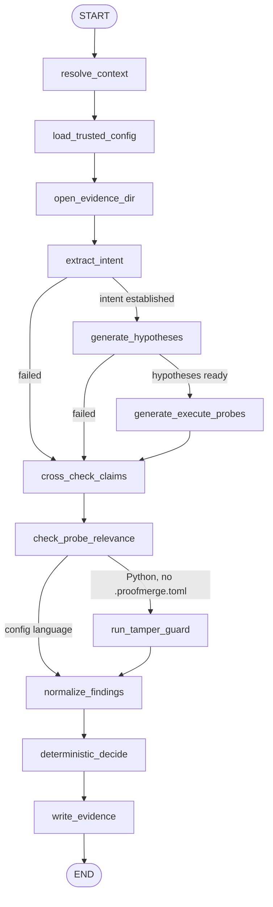

# Orchestration: legacy loop and LangGraph

`proofmerge verify` runs twelve stages, defined once in
`src/proofmerge/pipeline.py`. Each stage reads one shared `VerifyState` and returns
only the fields it changed; `errors` accumulates. Two orchestrators schedule them:

| | `legacy` (default) | `langgraph` |
|---|---|---|
| Install | nothing extra | `pip install 'proofmerge[graph]'` (LangGraph 1.2.15) |
| Scheduling | calls every stage in order; a stage whose inputs are missing returns nothing | `StateGraph` in `graph.py`; conditional edges skip those stages |
| Transient model failure (HTTP 429/5xx, no connection) | REVIEW reason | retried, up to 2 more attempts with backoff, in the four model-only nodes; then a REVIEW reason |
| Sandbox stages | run once | run once, never retried |
| Verdict | `verdict.decide()` | `verdict.decide()` |
| `proof.json` `orchestration` | `{"engine": "legacy"}` | engine, LangGraph version, nodes taken, retries |

Choose one with `--orchestrator legacy|langgraph` or `PROOFMERGE_ORCHESTRATOR`
(the GitHub Action's `orchestrator` input sets the variable). To roll back, set it
to `legacy`; no code change is needed.

## The graph

`resolve_context`, `load_trusted_config` and `open_evidence_dir` are preflight:
their errors (bad ref, oversized diff, existing evidence directory) propagate before
any model call or write, as in the legacy loop.

## Rules the graph keeps

- **One verdict authority.** Only `deterministic_decide` produces a `Verdict`, by
  calling `verdict.decide()` on normalized evidence. No node reads a model's opinion
  as evidence. The `orchestration` record is never read by the policy.
- **Retries only where they are safe.** `extract_intent`, `generate_hypotheses`,
  `cross_check_claims` and `check_probe_relevance` make model calls and nothing
  else. They retry only on a `MetaError` marked `transient`, and every attempt
  counts against the run's `MetaClient` call budget.
- **No retry around evidence.** `generate_execute_probes` and `run_tamper_guard` run
  the sandbox; each probe already runs a fixed, recorded number of attempts. A
  failure there becomes a REVIEW reason, with completed experiments kept.
- **Partial evidence survives.** A later stage failing adds a REVIEW reason; a
  verified regression already collected can still BLOCK.
- **Sequential model calls.** The two Wonder checks are independent but run one after
  the other: `MetaClient`'s call budget and usage counters are not thread-safe.

## How parity is checked

- `tests/test_graph.py` runs nine PASS, REVIEW and BLOCK scenarios through both
  orchestrators against the same repository and requires the same `proof.json`
  (apart from the `orchestration` record) and the same evidence files, byte for
  byte. Absolute evidence paths are normalized.
- CI's `graph-parity` job runs all of `tests/test_pipeline.py` with
  `PROOFMERGE_ORCHESTRATOR=langgraph`.
- CI's `docker` job runs the real-Docker demo end to end on both orchestrators.

## Not built yet

- **Checkpointing and resume.** The graph compiles without a checkpointer. Resuming
  safely needs idempotent experiment keys, so that a resumed run never re-executes
  or double-records a probe; until then an interrupted run is simply re-run.
- **OpenTelemetry spans.** Node names are recorded in `proof.json`; no tracer is wired.
